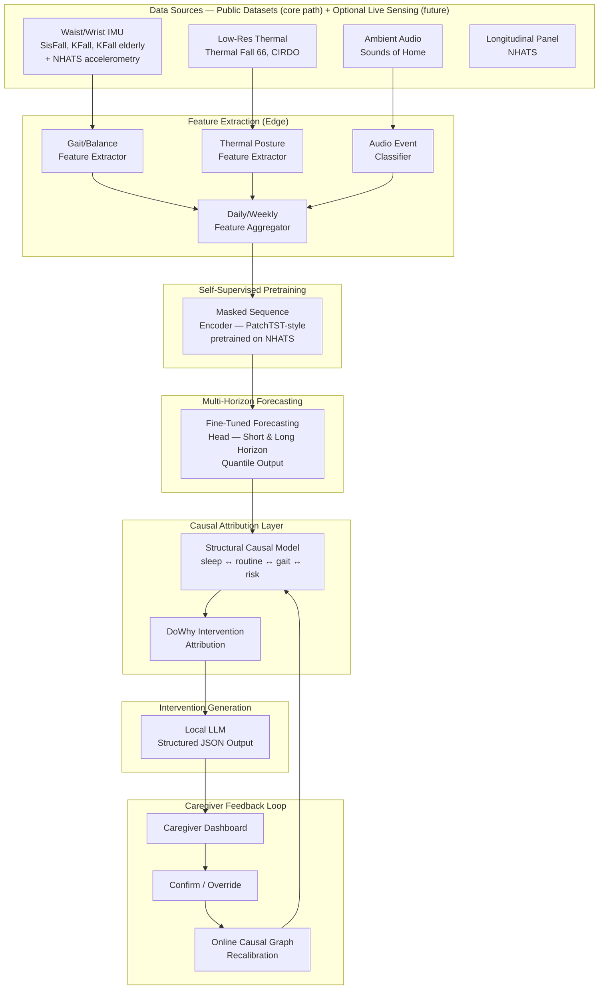
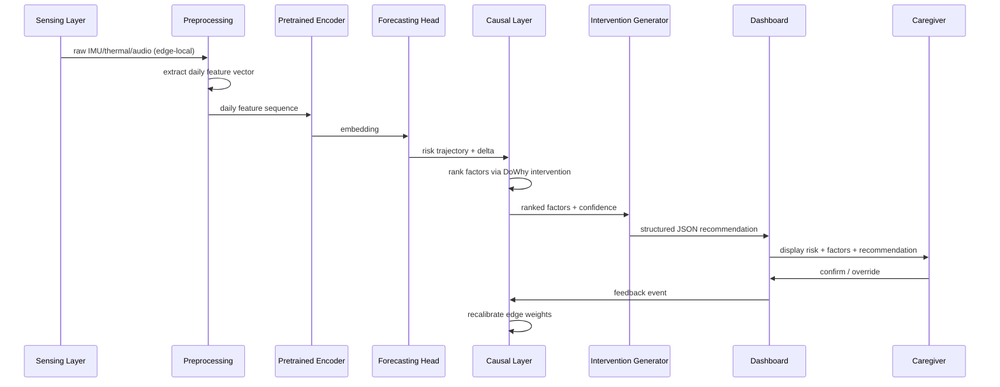

# Mimamori — Causal, Self-Supervised, Closed-Loop Home Frailty Forecasting — Technical Documentation

> **Version:** 1.0
> **Last updated:** 2026-08-29
> **Language / Runtime:** Python 3.11 · PyTorch 2.x · Hugging Face Transformers · DoWhy / causal-learn · ONNX Runtime · Streamlit 1.30+
> **Architecture style:** Closed-loop multimodal forecasting pipeline with causal attribution and human-confirmed online recalibration

---

## Table of Contents

1. [System Overview](#1-system-overview)
2. [Architecture Breakdown](#2-architecture-breakdown)
3. [Domain Model](#3-domain-model)
4. [Execution Flow](#4-execution-flow)
5. [Self-Supervised Pretraining Layer](#5-self-supervised-pretraining-layer)
6. [Causal Attribution Layer](#6-causal-attribution-layer)
7. [Intervention Generation & Feedback Loop](#7-intervention-generation--feedback-loop)
8. [Key Design Decisions](#8-key-design-decisions)
9. [Failure & Edge Case Analysis](#9-failure--edge-case-analysis)
10. [Training & Evaluation Pipeline](#10-training--evaluation-pipeline)
11. [Caregiver Dashboard](#11-caregiver-dashboard)
12. [Developer Onboarding Guide](#12-developer-onboarding-guide)
13. [Security & Privacy Considerations](#13-security--privacy-considerations)
14. [Suggested Improvements](#14-suggested-improvements)

---

## 1. System Overview

### Purpose

Mimamori is a **closed-loop system that forecasts fall risk** in older adults from multimodal behavioral data (gait, posture, ambient activity, sleep), attributes *why* risk is changing to specific upstream factors using causal — not merely correlational — inference, and generates caregiver-actionable interventions that are confirmed or overridden by a human, closing the loop back into the model.

**Prediction target, stated precisely:** the primary output is a **fall-risk trajectory** (probability of a fall event over a short and a long horizon), not a vague combined "frailty and fall" score. Frailty-related variables (gait speed, activity level, sleep, weight/strength proxies where available) are used as **predictors**, not as a separate output — frailty is the broader physical-decline condition; fall risk is the specific, actionable consequence this system forecasts. Keeping these separate avoids conflating two different things in the evaluation and in any writeup.

**Build order:** the system is built and validated entirely on public longitudinal/behavioral datasets and a self-built synthetic causal dataset — no live household sensing is required to reach a complete, defensible, ablation-backed result. A physical sensor pod (IMU + thermal + ambient audio, described below) is an **optional future extension** for a real-pilot deployment, not a dependency for the core research contribution. This matters for scoping: the novelty here is in the forecasting, self-supervision, and causal-attribution pipeline, not in sensor engineering.

Three properties distinguish it from existing fall-risk or activity-monitoring systems:

1. **Self-supervised pretraining on real longitudinal aging data** (NHATS) rather than training from scratch on small labeled fall datasets — this is what makes multi-week forecasting realistic given how little labeled longitudinal fall-risk data exists anywhere.
2. **Causal attribution** of risk change to upstream factors (sleep, routine, gait) via structural causal modeling, evaluated against a synthetic dataset with known ground-truth causal structure — not attention-weight saliency dressed up as an explanation.
3. **A structurally required human-in-the-loop step** — no intervention is logged as "acted on" without caregiver confirmation, and every confirmation/override recalibrates the causal graph.

### High-Level Architecture



### Core Responsibilities

| Responsibility | Owner |
|---|---|
| Passive multimodal signal capture | Sensing layer (edge device) |
| Feature extraction (gait, posture, audio events) | Preprocessing module |
| Representation learning from scarce labels | Self-supervised pretraining (NHATS-based) |
| Multi-horizon, calibrated risk forecasting | Forecasting head |
| Causal (not correlational) root-cause attribution | Causal attribution layer |
| Human-readable, actionable recommendations | LLM intervention generator |
| Structural human-in-the-loop confirmation | Caregiver dashboard |
| Online model recalibration from feedback | Feedback loop module |
| Ablation-based evaluation | Evaluation harness |

---

## 2. Architecture Breakdown

### Major Components

#### Sensing Layer (`src/sensing/`)

Three passive modalities, none of which transmit raw imagery off-device:
- **IMU** (`imu_capture.py`): waist or wrist-worn accelerometer/gyroscope, 100Hz.
- **Thermal** (`thermal_capture.py`): low-resolution thermal array (e.g., 32×24 grid-eye class sensor), used for posture/fall silhouette detection — never RGB video.
- **Ambient audio** (`audio_capture.py`): always-on microphone processed locally into event labels (footsteps, falls, distress sounds, routine activity) — raw audio is discarded after feature extraction, only event labels persist.

#### Preprocessing Module (`src/preprocess/`)

| Operation | Purpose | Source Datasets Used to Train/Validate |
|---|---|---|
| Gait/balance feature extraction | Cadence, stride variability, sway | SisFall, KFall, KFall elderly add-in |
| Thermal posture/fall silhouette extraction | Fall vs. ADL posture classification | Thermal Fall 66, CIRDO |
| Ambient audio event classification | Routine detection, distress/fall sound events | Sounds of Home |
| Daily/weekly feature aggregation | Converts window-level features into the day/week-level tokens the forecaster consumes | eHomeSeniors (multi-day smart-home context), NHATS (real longitudinal structure) |

#### Self-Supervised Pretraining Module (`pretrain/`)

Masked sequence reconstruction over daily-feature sequences, pretrained primarily on **NHATS** (a real longitudinal panel of older U.S. adults) and **NHATS accelerometry** (the physical-activity sub-study), giving the encoder exposure to genuine multi-week aging trajectories rather than only short lab-trial sessions. See [Section 5](#5-self-supervised-pretraining-layer).

#### Forecasting Module (`forecast/`)

Fine-tunes the pretrained encoder with a quantile-regression forecasting head, using SisFall/KFall/KFall-elderly (fall vs. ADL, gait severity) as proxy supervised labels and eHomeSeniors for longer-window context.

#### Causal Attribution Module (`causal/`)

A structural causal model over behavioral factors, validated against a purpose-built **synthetic longitudinal causal dataset** with known ground truth. See [Section 6](#6-causal-attribution-layer).

#### Intervention & Feedback Modules (`intervene/`, `feedback/`)

Local LLM generates structured recommendations from ranked causal factors; caregiver confirmation writes back into the causal graph's edge weights. See [Section 7](#7-intervention-generation--feedback-loop).

---

## 3. Domain Model

### Dataset Roles

| Dataset | Modality | Role in Pipeline |
|---|---|---|
| **SisFall** | Waist IMU | Gait/fall feature extractor training; includes a real elderly (60–75) subgroup |
| **KFall** | IMU (larger scale) | Pre-impact motion patterns; gait feature extractor generalization |
| **KFall elderly add-in** | IMU | Elderly-specific supplement to KFall's younger-skewed base cohort |
| **NHATS** | Longitudinal panel (functional/health survey) | Self-supervised pretraining corpus — real multi-year aging trajectories |
| **NHATS accelerometry** | Wearable activity sub-study | Links NHATS's longitudinal structure to real movement/activity signal for pretraining |
| **eHomeSeniors** | Multi-sensor smart home | Daily/weekly context aggregation; multi-day household routine structure |
| **Sounds of Home** | Ambient audio | Audio event classifier training (routine, distress, fall sounds) |
| **Thermal Fall 66** | Thermal imaging | Thermal posture/fall-silhouette classifier training |
| **CIRDO** | Thermal/depth fall detection | Secondary thermal/posture validation set, cross-dataset generalization check |
| **Synthetic longitudinal causal dataset** | Simulated (self-built) | Ground-truth causal structure for validating the attribution layer — see Section 6 |

### Core Data Objects

```python
DailyFeatureVector = {
    "date": date,
    "gait_cadence": float, "stride_variability": float, "sway_index": float,
    "posture_fall_events": int, "posture_instability_score": float,
    "audio_routine_score": float, "audio_distress_events": int,
    "sleep_proxy": float, "routine_deviation": float,
}

RiskForecast = {
    "horizon": "short" | "long",
    "risk_quantiles": {"p10": float, "p50": float, "p90": float},
    "confidence": float,
}

CausalAttribution = {
    "risk_delta": float,
    "ranked_factors": [{"factor": str, "estimated_contribution": float}],
    "method": "dowhy_intervention",
}

CaregiverFeedbackEvent = {
    "timestamp": datetime,
    "attribution_shown": CausalAttribution,
    "confirmed_factor": str | None,
    "action": "confirmed" | "overridden" | "dismissed",
}
```

---

## 4. Execution Flow



---

## 5. Self-Supervised Pretraining Layer

- **Objective:** masked reconstruction of daily-feature patches (30–40% masking), architecture based on PatchTST.
- **Primary corpus:** NHATS + NHATS accelerometry — chosen specifically because it is *real* longitudinal elderly data (not simulated trial sessions), giving the encoder genuine exposure to how functional/activity trajectories actually drift over months, which SisFall/KFall-style single-session lab data cannot provide.
- **Secondary corpus:** eHomeSeniors, for multi-day smart-home routine structure that complements NHATS's survey-and-accelerometry format with sensor-native daily patterns.
- **Validation before proceeding to Stage 6 (forecasting fine-tune):** cluster embeddings by NHATS's own functional-status categories (self-reported mobility limitation levels) — the pretrained space should separate these without ever having been trained to predict them directly. This is the pretraining sanity check; do not proceed until it passes.

---

## 6. Causal Attribution Layer

The central engineering risk in the whole system: no dataset above gives real ground-truth causal structure between sleep/routine/gait/risk. The **synthetic longitudinal causal dataset** exists specifically to solve this.

- **Construction:** a hand-specified structural causal model (SCM) — nodes: `sleep_quality`, `routine_deviation`, `gait_stability`, `medication_adherence_proxy`, `fall_risk` — with specified edges (e.g., `sleep_quality → gait_stability → fall_risk`) and injected noise, used to generate multi-week household trajectories where the true causal graph is known by construction.
- **Method:** `DoWhy` for intervention-style effect estimation (do-calculus), `causal-learn` (PC algorithm / Granger causality) as a structure-learning cross-check against the hand-specified graph.
- **Real-data grounding:** once the attribution method is validated on the synthetic set, it's applied to real feature trajectories from eHomeSeniors/NHATS to check that attributed factors are at least directionally plausible (e.g., does a real routine disruption event correlate with the factor the causal layer would have flagged) — this is a plausibility check, not a validation, and should be labeled as such in any writeup.
- **Baseline for comparison:** attention-weight saliency from the forecasting transformer (correlational) — Ablation #2 in Section 10.

---

## 7. Intervention Generation & Feedback Loop

- Local instruction-tuned LLM (Llama/Qwen-family, 7–8B), constrained to structured JSON output via `outlines`/`guidance` grammar constraints.
- Caregiver confirmation is a **structural requirement**, not a UX nicety: no attribution is treated as "acted on" without it, and the dashboard cannot mark an alert resolved without a logged confirm/override event.
- Feedback events update the causal graph's edge-weight priors (lightweight Bayesian update via `DoWhy`'s effect-estimation API) — this is what Ablation #3 tests: does the loop measurably improve attribution accuracy over cycles, or is it inert.

---

## 8. Key Design Decisions

| Decision | Rationale |
|---|---|
| Engineered daily features, not raw sensor rate, as pretraining tokens | Keeps the representation clinically interpretable, which the causal layer depends on downstream |
| NHATS as primary pretraining corpus over lab-trial datasets | Real longitudinal structure; lab-trial datasets (SisFall/KFall) capture single-session movement quality, not multi-week drift |
| Synthetic causal dataset for attribution validation | No public dataset provides ground-truth causal structure; synthetic generation is the only way to get an honestly evaluable ground truth |
| Structural (not optional) caregiver confirmation step | Prevents the system from silently acting on unvalidated attributions; matches the safety-critical framing (decision support, not autonomous action) |
| Thermal + audio over RGB video | No raw imagery ever leaves the device — the strongest available privacy argument to a real care provider |

---

## 9. Failure & Edge Case Analysis

| Scenario | Risk | Mitigation |
|---|---|---|
| NHATS pretraining representation doesn't separate functional-status groups | Downstream forecasting has nothing useful to fine-tune on | Sanity-check gate in Section 5; do not proceed until it passes |
| Thermal/audio classifiers trained on Thermal Fall 66 / CIRDO / Sounds of Home don't generalize to a real household's sensor placement | False alerts or missed events at deployment | Cross-dataset validation (train on one, test on the other) before any real pilot |
| Causal attribution flags an implausible factor | Erodes caregiver trust in the system | Confidence-gated abstention; caregiver override always available and logged |
| Feedback loop overfits to a single caregiver's confirmation bias | Causal graph drifts away from ground truth | Bound online updates — revert if attribution accuracy on the synthetic held-out set degrades beyond a threshold |
| No real household pilot obtained in project timeline | Real-world validation missing | Core pipeline (Stages 1–7) is fully defensible on public + synthetic data alone; pilot strengthens, doesn't block |
| Modality mismatch between NHATS accelerometry (low-resolution actigraphy) and SisFall/KFall (high-frequency waist IMU) | Pretraining and fine-tuning corpora aren't directly comparable at the raw-signal level | Both are aggregated down to the same daily engineered features (cadence, variability, etc.) before pretraining — this design choice is what makes the two sources compatible; document it as deliberate, not incidental |
| No dataset directly measures sleep, despite `sleep_quality` being a causal-graph node | Weakest-grounded factor in the attribution layer | Derive a sleep proxy from NHATS self-reported sleep items + audio-inferred nighttime activity from Sounds of Home; flag this node as lower-confidence than gait/routine in any writeup |
| Sounds of Home has no second dataset to cross-validate against (unlike thermal's two-source setup) | Audio event classifier generalization is less tested than thermal | Treat as a smaller, named risk rather than hiding the asymmetry; revisit if a second audio source becomes available |
| All fall events across every fall dataset (SisFall, KFall, Thermal Fall 66, CIRDO) are staged/simulated, not real falls | Field-wide limitation, not specific to this project | State plainly in the limitations section — one sentence, not a footnote |
| Subject-level data leakage if splits are done at the window/session level | Inflated, unreliable metrics across all downstream evaluation | All splits (SisFall, KFall, KFall elderly add-in, Thermal Fall 66, CIRDO, Sounds of Home) performed at the subject level and frozen before feature extraction — see §2.5 in tasks.md |
| Granularity mismatch: NHATS/eHomeSeniors give real daily/weekly sequences for pretraining, but SisFall/KFall/KFall-elderly are single-session trials with no such structure | Fine-tuning stage has no valid input format without a bridge | Concatenate each subject's trial windows into a documented synthetic "week" (`forecast/session_to_sequence.py`) — explicit, named workaround, stated as a limitation in any writeup |
| No defined interface between the forecasting head's output and the causal layer's input | Causal ranking (§6) has nothing well-specified to consume | Forecasting head exports `risk_delta` as a first-class output — the single quantity the causal attribution layer's top-k ranking consumes |
| Personalization (§10) and causal-graph recalibration (§7) both modify per-household model state with no defined order | Risk of the two modules double-counting the same signal | Personalization runs first each cycle, so the causal layer sees a risk delta already relative to the household's own norm |

---

## 10. Training & Evaluation Pipeline

Four ablations, run as config flags in a single harness (not separate scripts):

| Experiment | Disabled Component | Degraded Metric |
|---|---|---|
| No pretraining | NHATS self-supervised stage | Forecasting AUROC/AUPRC in small-data regime |
| No causal layer | DoWhy attribution → attention saliency | Top-k root-cause accuracy on synthetic SCM |
| No feedback loop | Causal graph frozen | Attribution accuracy over successive cycles (flat vs. improving) |
| Single-horizon | One forecast window only | AUROC at the untrained horizon |

Metrics: AUROC/AUPRC per horizon, calibration (reliability diagrams via `netcal`), lead-time-to-event, top-k causal accuracy on the synthetic dataset, abstention rate, caregiver-rated usefulness, and a **false-negative-weighted safety score** — missed real risk is weighted more heavily than a false alarm, since the two failure modes are not equally costly in this setting.

### Per-Household Personalization

The forecasting head's reference "normal" is not fixed to the population baseline it was pretrained/fine-tuned on — it drifts toward each household's own history over time (`feedback/personalize.py`), so a household with a stable-but-atypical routine doesn't get flagged against a population norm that never applied to them. This is evaluated separately from the four core ablations: personalized vs. non-personalized forecasting on synthetic multi-household trajectories, checking specifically that the drift correction adapts the *baseline* rather than silently raising the *alert threshold* (which would mask genuine risk changes instead of correctly contextualizing them).

---

## 11. Caregiver Dashboard

Streamlit app (`dashboard/app.py`) reading from the feedback log and model outputs: risk trajectory (short + long horizon), ranked causal factors, LLM-generated recommendation, confirm/override control. Deliberately minimal — the frontend is not the project's technical contribution.

---

## 12. Developer Onboarding Guide

```bash
git clone <repo> && cd mimamori
python -m venv venv && source venv/bin/activate
pip install torch transformers pytorch-lightning dowhy causal-learn \
    scikit-learn onnx onnxruntime netcal outlines streamlit pandas numpy wandb

# Stage-by-stage entry points
python -m pretrain.train --config configs/pretrain_nhats.yaml
python -m forecast.finetune --config configs/forecast.yaml
python -m causal.simulate --config configs/synthetic_scm.yaml
python -m causal.fit --config configs/causal_attribution.yaml
python -m intervene.generate --config configs/llm.yaml
streamlit run dashboard/app.py
```

Run `python -m eval.run_ablation --all` to reproduce the four-ablation table before making any claim about which component matters.

---

## 13. Security & Privacy Considerations

| Concern | Approach |
|---|---|
| Raw video never used | Thermal + audio-event only; audio is discarded after local feature extraction |
| Sensitive longitudinal health-adjacent data at rest | Encrypt feature store; no raw sensor data persisted beyond the extraction window |
| Caregiver dashboard access | Bind to localhost or require auth in any multi-household deployment; no auth built in for the single-household research prototype |
| NHATS/public dataset licensing | NHATS requires a data use agreement for restricted files — use the public-use files where possible and document any restricted-access requirement before relying on it |

---

## 14. Suggested Improvements

| Priority | Issue | Fix |
|---|---|---|
| Critical | Causal attribution validated only on synthetic + plausibility-checked on real data, never on real ground truth | Be explicit about this limitation in any paper; do not claim causal validity beyond the synthetic evaluation |
| High | No cross-dataset generalization test between Thermal Fall 66 and CIRDO before deployment | Add a train-on-one/test-on-other harness before any real pilot |
| High | Online causal recalibration could drift from repeated caregiver error | Add automatic revert if synthetic held-out accuracy degrades beyond a threshold |
| Medium | NHATS pretraining and eHomeSeniors daily aggregation use different feature schemas | Build one shared `DailyFeatureVector` schema (Section 3) and adapt both sources into it explicitly, rather than ad hoc per-dataset code |
| Low | No experiment tracking standardized across stages | Adopt `wandb` project-wide from Stage 0, not added later |
